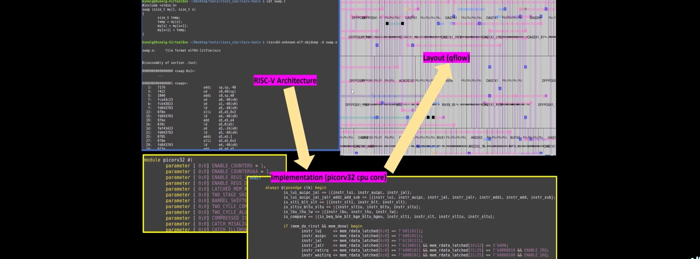
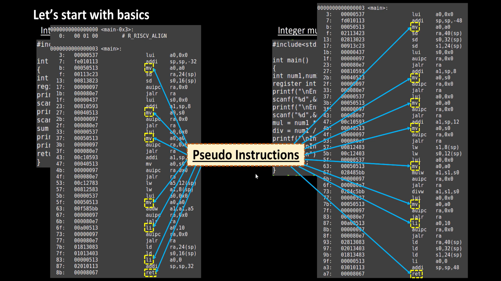
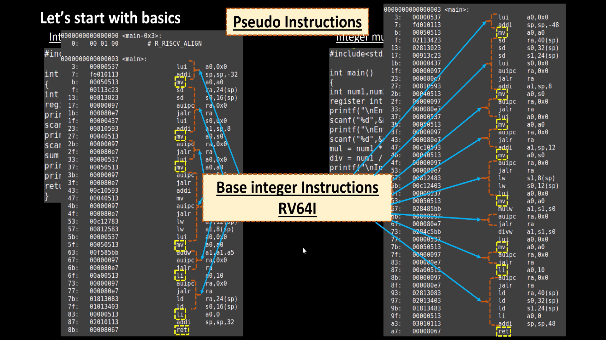
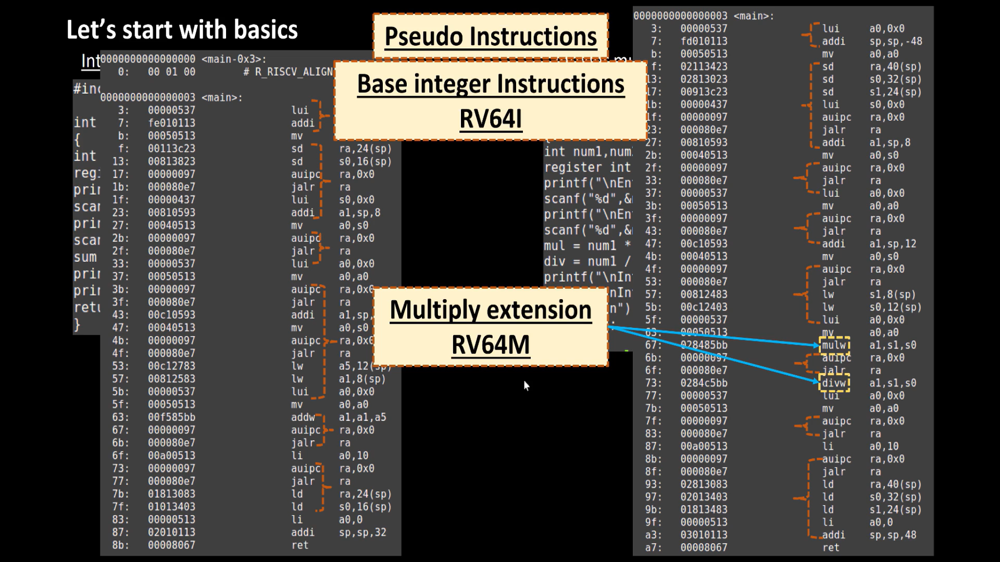
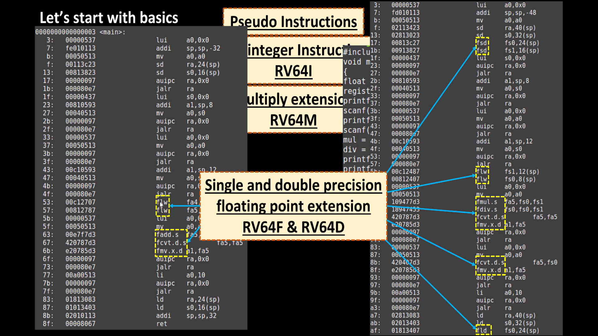
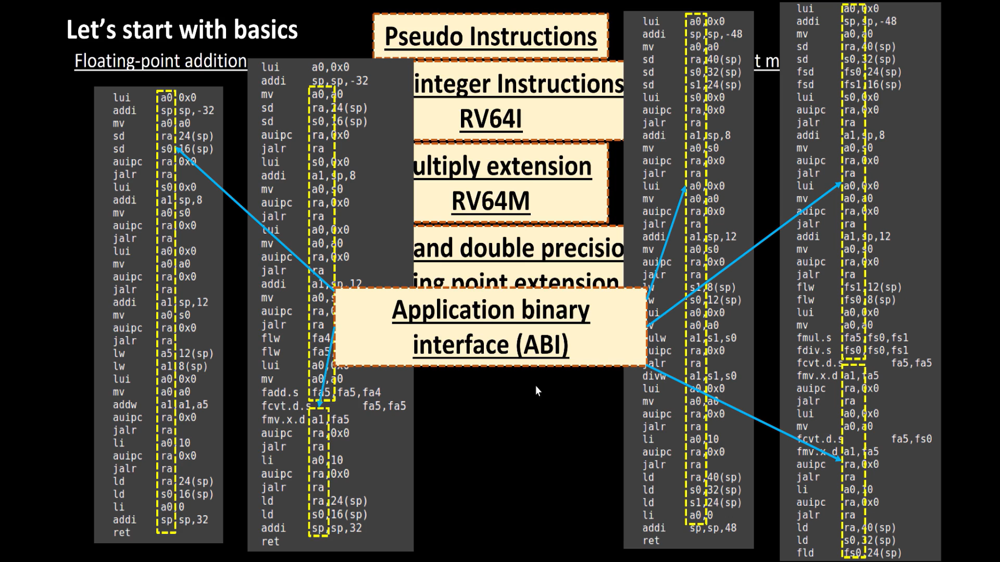
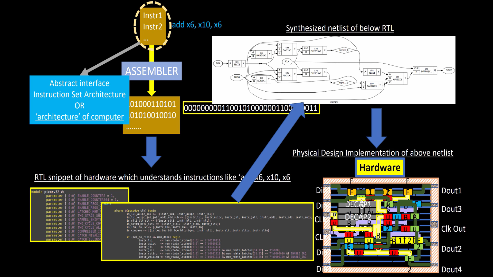
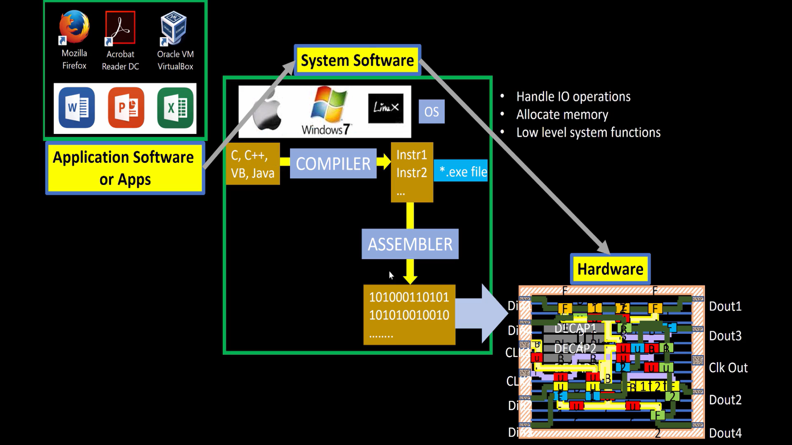

# RISC-V Architecture – From C Programming to RTL and Physical Design

## About This Repository

This repository documents my hands-on learning journey of **RISC-V Architecture**, covering everything from basic C programming and instruction-set concepts to RTL design, logic synthesis, and physical design.

The main objective is to understand how a high-level C program is converted into machine instructions and how a RISC-V processor executes these instructions using digital hardware.

Through practical experiments, I explore the relationship between software, processor architecture, RTL implementation, and VLSI physical design.

## Learning Flow

1. RISC-V Architecture Basics
2. C Programming
3. RISC-V Assembly Language
4. Pseudo Instructions
5. RV64I – Base Integer Instructions
6. RV64M – Multiply Extension
7. RV64F and RV64D – Floating-Point Extensions
8. ABI – Application Binary Interface
9. RISC-V Compiler and Toolchain
10. PicoRV32 RTL Implementation
11. Logic Synthesis
12. Physical Design

---

# 1. Introduction to RISC-V

RISC-V is an open-standard Instruction Set Architecture (ISA) based on Reduced Instruction Set Computer (RISC) principles.

An ISA defines the instructions that a processor understands and executes.

Some basic instructions are:

- ADD – Addition
- SUB – Subtraction
- LOAD – Read data from memory
- STORE – Write data to memory
- BRANCH – Change program execution flow

RISC-V acts as an interface between software and hardware.

# 2. Software-to-Hardware Flow

A computer system consists of three important layers:

- Application Software
- System Software
- Hardware

### Working Principle

1. A programmer writes a program in C or another high-level language.
2. The compiler converts the source code into assembly instructions.
3. The assembler converts assembly instructions into machine code.
4. The linker combines object files and generates an executable.
5. The processor executes the instructions using its hardware.



---

# 3. RISC-V Instruction Set Extensions

RISC-V supports a base instruction set and optional extensions.

## 3.1 Pseudo Instructions

Pseudo-instructions are simplified assembly instructions provided by the assembler for programmer convenience.

They are translated into one or more actual machine instructions.

Example:

```asm
mv a0, a1
```

Equivalent instruction:

```asm
addi a0, a1, 0
```

Other examples:

| Pseudo Instruction | Meaning |
|---|---|
| NOP | No operation |
| MV | Copy register value |
| LI | Load immediate value |
| RET | Return from function |



## 3.2 RV64I – Base Integer Instructions

RV64I is the 64-bit base integer instruction set.

It provides fundamental arithmetic, logical, memory access, and control-flow instructions.

Examples:

| Instruction | Function |
|---|---|
| ADD | Addition |
| SUB | Subtraction |
| ADDI | Add immediate |
| AND | Bitwise AND |
| OR | Bitwise OR |
| XOR | Bitwise XOR |
| LW | Load word |
| LD | Load double word |
| SW | Store word |
| SD | Store double word |
| BEQ | Branch if equal |
| JAL | Jump and link |



## 3.3 RV64M – Multiply Extension

RV64M adds multiplication and division instructions to the base integer instruction set.

Examples:

- MUL – Multiplication
- MULH – Multiplication high bits
- DIV – Integer division
- REM – Remainder operation



## 3.4 RV64F and RV64D – Floating Point Extensions

These extensions support floating-point operations.

**RV64F:** Single-precision floating-point operations (32-bit).

**RV64D:** Double-precision floating-point operations (64-bit).

Examples:

| Instruction | Function |
|---|---|
| FLW | Load single-precision value |
| FLD | Load double-precision value |
| FSW | Store single-precision value |
| FSD | Store double-precision value |
| FADD.S | Single-precision addition |
| FDIV.D | Double-precision division |



---

# 4. ABI – Application Binary Interface

ABI defines the conventions used by software components to communicate with each other.

It specifies:

- Register usage
- Function calling conventions
- Stack management
- Function arguments and return values

### Important RISC-V Registers

| Register | ABI Name | Purpose |
|---|---|---|
| x1 | ra | Return address |
| x2 | sp | Stack pointer |
| x5–x7 | t0–t2 | Temporary registers |
| x8–x9 | s0–s1 | Saved registers |
| x10–x17 | a0–a7 | Function arguments and return values |



---

# 5. C Programming and RISC-V Compilation

A simple C program helps understand how software is converted into processor instructions.

### Example: Sum of Numbers from 1 to 100

```c
#include <stdio.h>

int main(void)
{
    int i, sum = 0, n = 100;

    for (i = 1; i <= n; i++)
    {
        sum += i;
    }

    printf("Sum of numbers from 1 to %d is %d\n", n, sum);

    return 0;
}
```

### Expected Output

```text
Sum of numbers from 1 to 100 is 5050
```

### RISC-V Compilation Commands

Compile the C program:

```bash
riscv64-unknown-elf-gcc -O1 -march=rv64i -mabi=lp64 -o sum1ton.elf sum1ton.c
```

Generate assembly code:

```bash
riscv64-unknown-elf-gcc -O1 -march=rv64i -mabi=lp64 -S sum1ton.c -o sum1ton.s
```

Generate disassembly:

```bash
riscv64-unknown-elf-objdump -d sum1ton.elf
```

Check executable format:

```bash
riscv64-unknown-elf-objdump -f sum1ton.elf
```

## Compiler Optimization

Compare different compiler optimization levels.

### O1 Optimization

```bash
riscv64-unknown-elf-gcc -O1 -march=rv64i -mabi=lp64 -o sum_O1.elf sum1ton.c
```

### Ofast Optimization

```bash
riscv64-unknown-elf-gcc -Ofast -march=rv64i -mabi=lp64 -o sum_Ofast.elf sum1ton.c
```

Inspect the generated machine instructions:

```bash
riscv64-unknown-elf-objdump -d sum_O1.elf
riscv64-unknown-elf-objdump -d sum_Ofast.elf
```

Compiler optimization can change the number and sequence of instructions generated.

The disassembly output helps us understand how compiler decisions affect the final machine code.

---

# 6. RISC-V Toolchain

A toolchain is a collection of software tools used to convert source code into executable machine code.

| Tool | Purpose |
|---|---|
| GCC | Compiles C programs |
| Assembler | Converts assembly into machine code |
| Linker | Combines object files |
| objdump | Displays machine instructions |
| readelf | Displays ELF file information |

### Compilation Flow

```text
C Source Code
     |
     v
Compiler (GCC)
     |
     v
Assembly Code
     |
     v
Assembler
     |
     v
Object File
     |
     v
Linker
     |
     v
Executable ELF File
     |
     v
Disassembler (objdump)
     |
     v
RISC-V Machine Instructions
```

---

# 7. From ISA to RTL – PicoRV32

The Instruction Set Architecture defines **WHAT** a processor should execute.

RTL defines **HOW** the processor hardware implements those instructions.

PicoRV32 is a small RISC-V CPU core written in Verilog.

Studying PicoRV32 helps understand the connection between processor instructions and digital hardware.

## Three Major Stages

### Part 1 – RISC-V Instruction Set Architecture

- Understand instruction formats.
- Learn registers and instruction extensions.
- Study assembly instructions.
- Understand the relationship between C and assembly.

### Part 2 – RTL and Synthesis

- Explore PicoRV32 Verilog RTL.
- Understand processor datapath and control logic.
- Study how instructions are decoded.
- Convert RTL into a synthesized gate-level netlist.

### Part 3 – Physical Design

- Floorplanning
- Placement
- Clock Tree Synthesis
- Routing
- Chip Layout



## RTL to Physical Design Flow

```text
RISC-V ISA
    |
    v
PicoRV32 RTL (Verilog)
    |
    v
RTL Synthesis
    |
    v
Gate-Level Netlist
    |
    v
Floorplanning
    |
    v
Placement
    |
    v
Clock Tree Synthesis
    |
    v
Routing
    |
    v
Final Chip Layout
```



---

# 8. Development Environment

Practical experiments are performed using Ubuntu Linux running inside Oracle VirtualBox.

### Tools Explored

- Ubuntu Linux
- RISC-V GNU Toolchain
- GCC
- Assembler
- Linker
- objdump
- Verilog
- PicoRV32
- Yosys
- Physical Design Tools

The development environment is used to compile C programs, inspect assembly instructions, explore RTL, and perform synthesis-related experiments.


---

# 9. Learning Outcomes

Through this learning journey, I aim to develop practical understanding of:

- RISC-V Instruction Set Architecture.
- C-to-Assembly and Assembly-to-Machine-Code conversion.
- RISC-V instruction formats and extensions.
- Pseudo-instructions and ABI.
- Compiler optimization and disassembly.
- Processor architecture and RTL implementation.
- Logic synthesis and gate-level netlists.
- RTL-to-GDSII physical design flow.

---

## Repository Structure

```text
RISCV_Lab1/
│
├── README.md
│
├── basic_1.png
├── basic_2.png
├── basic_3.png
├── basic_4.png
├── basic_5.png
│
├── course_design.png
├── flow_diagram_1.png
├── behavioural_diagram.png
├── ex_behavioural_diagram.png
├── setup_ubuntu_terminal.png
│
├── sum_no.c
├── 01_register_address...
├── Ofast_register_address...
│
└── Other practical files and screenshots
```

*Note: The filenames above are based on the visible repository files. Keep your actual filenames unchanged.*

---

## Repository Status

This repository is a continuous learning project.

Practical experiments, source codes, diagrams, screenshots, and implementation results will be added as the learning progresses.

## Key Topics

`RISC-V` `RV64I` `RV64M` `RV64F` `RV64D` `C Programming` `Assembly Language` `ABI` `PicoRV32` `Verilog RTL` `Yosys` `Synthesis` `Physical Design` `VLSI`
