# RISC-V Architecture – From C Programming to RTL and Physical Design

## About This Repository

This repository documents my hands-on learning journey of **RISC-V Architecture**, covering fundamental computer architecture concepts, C programming, RISC-V assembly language, instruction-set extensions, RTL design, logic synthesis, and physical design.

The main objective is to understand how a high-level C program is converted into machine instructions and how a RISC-V processor executes these instructions using digital hardware.

Through theoretical learning and practical experiments, I explore the relationship between software, processor architecture, RTL implementation, and VLSI physical design.

---

## Learning Flow

1. Introduction to Computer Architecture
2. Number Systems and Binary Representation
3. RISC-V Architecture Basics
4. C Programming
5. RISC-V Assembly Language
6. Pseudo Instructions
7. RV64I – Base Integer Instructions
8. RV64M – Multiply and Divide Extension
9. RV64F and RV64D – Floating-Point Extensions
10. ABI – Application Binary Interface
11. RISC-V Compiler and Toolchain
12. PicoRV32 RTL Implementation
13. Logic Synthesis
14. Physical Design

---

# 1. Introduction to Computer Architecture

Computer architecture describes the organization and working principles of a computer system.

A computer system consists of three important layers:

- Application Software
- System Software
- Hardware

### Working Principle

1. A programmer writes a program using a high-level language such as C.
2. The compiler translates the source code into assembly instructions.
3. The assembler converts assembly instructions into machine code.
4. The processor executes machine instructions using digital hardware.

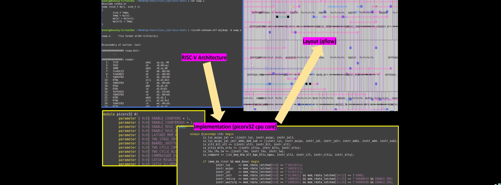

## 1.1 Software and Hardware Interaction

**Application Software:**
- C and C++ programs
- Desktop applications
- Embedded applications

**System Software:**
- Operating systems
- Compilers
- Assemblers
- Linkers

**Hardware:**
- Processor
- Memory
- Registers
- Digital logic circuits

System software manages hardware resources, memory allocation, I/O operations, and low-level system functions.

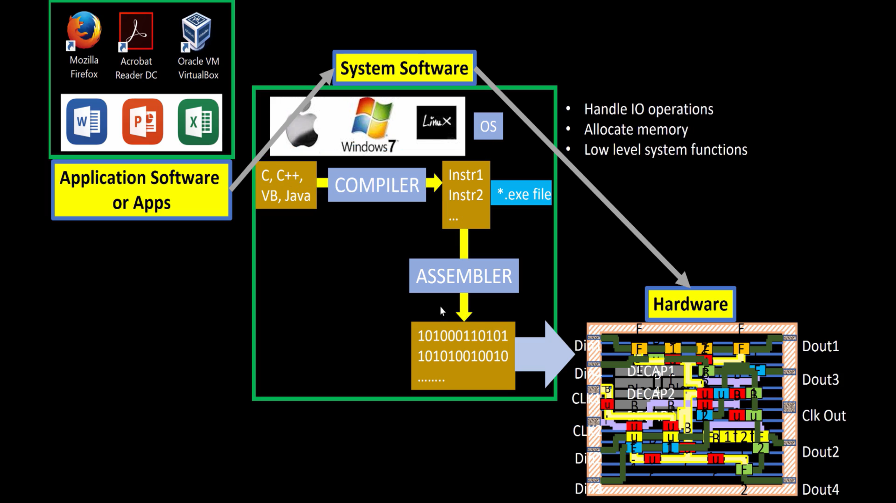

---

# 2. Number Systems and Binary Representation

Digital systems operate using binary data represented by 0s and 1s.

A binary number consists of individual bits, where each bit represents a power of two.

## 2.1 Number of Binary Patterns

The total number of patterns represented by n bits is:

\[
\text{Total Patterns} = 2^n
\]

Examples:

| Number of Bits | Total Patterns | Decimal Range |
|---|---:|---|
| 1 bit | 2 | 0 to 1 |
| 2 bits | 4 | 0 to 3 |
| 3 bits | 8 | 0 to 7 |
| 4 bits | 16 | 0 to 15 |
| 8 bits | 256 | 0 to 255 |
| 32 bits | 2^32 | 0 to 2^32 - 1 |
| 64 bits | 2^64 | 0 to 2^64 - 1 |

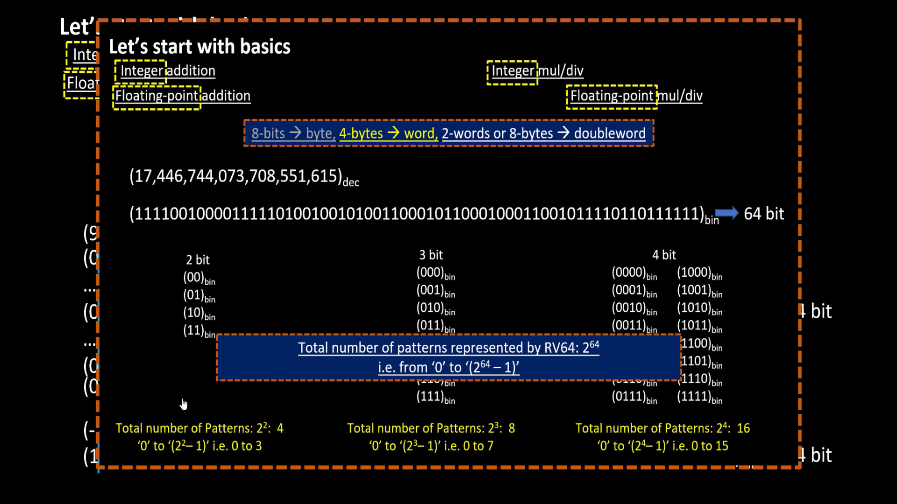

## 2.2 Data Representation

In computer architecture, data is represented using different bit widths.

| Data Unit | Size |
|---|---|
| Bit | 1 bit |
| Byte | 8 bits |
| Word (RV64) | 32 bits |
| Doubleword | 64 bits |

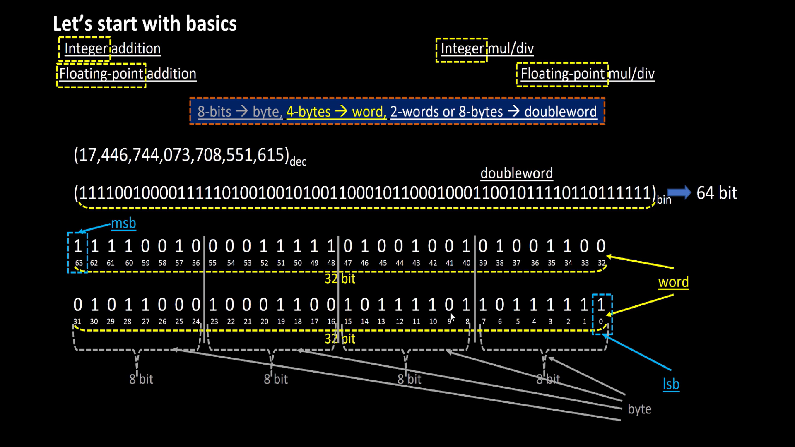

## 2.3 Signed and Unsigned Numbers

A 64-bit binary number can represent unsigned as well as signed integer values.

**Unsigned 64-bit range:**

\[
0 \text{ to } 2^{64}-1
\]

**Signed 64-bit range (Two's Complement):**

\[
-2^{63} \text{ to } 2^{63}-1
\]

The most significant bit (MSB) indicates the sign in signed two's-complement representation.

- MSB = 0: Non-negative number
- MSB = 1: Negative number

### Example: Two's Complement Representation of -2

```text
Binary representation of +2:

00000000 ... 00000010

Invert all bits:

11111111 ... 11111101

Add 1:

11111111 ... 11111110

Result = -2
```

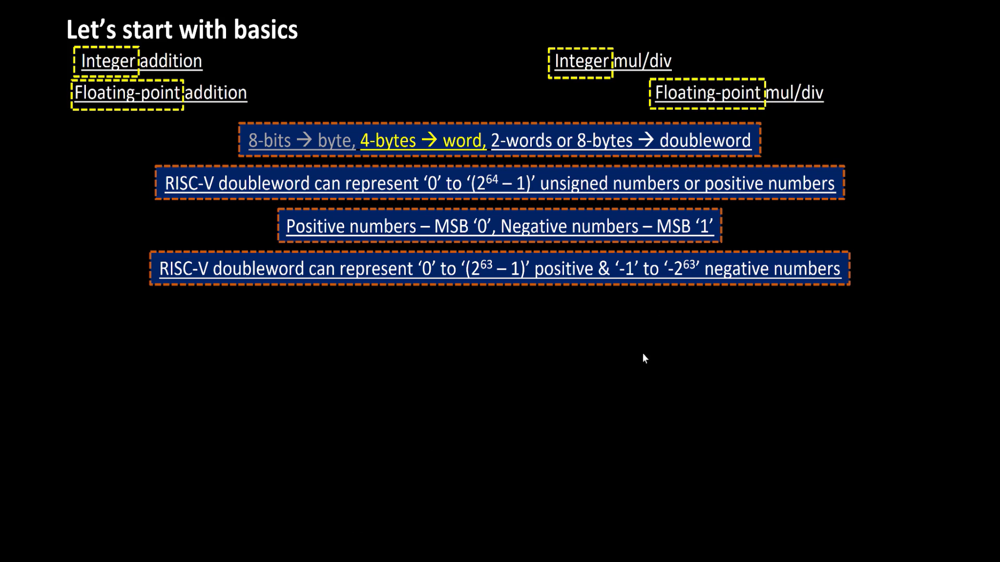

---

# 3. Introduction to RISC-V Architecture

RISC-V is an open-standard Instruction Set Architecture (ISA) based on Reduced Instruction Set Computer (RISC) principles.

An ISA defines the instructions that a processor understands and executes.

Some basic instructions are:

- ADD – Addition
- SUB – Subtraction
- LOAD – Read data from memory
- STORE – Write data to memory
- BRANCH – Change program execution flow

RISC-V acts as an interface between software and hardware.

## 3.1 RISC-V Instruction Set Extensions

RISC-V supports a base instruction set and optional extensions.

### Pseudo Instructions

Pseudo-instructions are simplified assembly instructions provided by the assembler for programmer convenience.

They are translated into one or more actual machine instructions.

Example:

```asm
mv a0, a1
```

Equivalent instruction:

```asm
addi a0, a1, 0
```

Other examples:

| Pseudo Instruction | Meaning |
|---|---|
| NOP | No operation |
| MV | Copy register value |
| LI | Load immediate value |
| RET | Return from function |

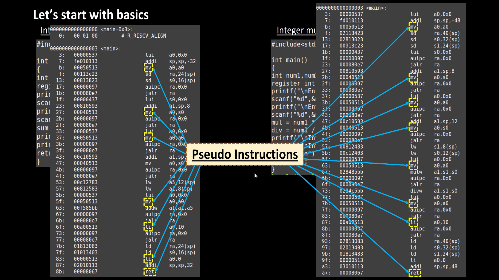

### RV64I – Base Integer Instructions

RV64I is the 64-bit base integer instruction set.

It provides fundamental arithmetic, logical, memory access, and control-flow instructions.

Examples:

| Instruction | Function |
|---|---|
| ADD | Addition |
| SUB | Subtraction |
| ADDI | Add immediate |
| AND | Bitwise AND |
| OR | Bitwise OR |
| XOR | Bitwise XOR |
| LW | Load word |
| LD | Load doubleword |
| SW | Store word |
| SD | Store doubleword |
| BEQ | Branch if equal |
| JAL | Jump and link |

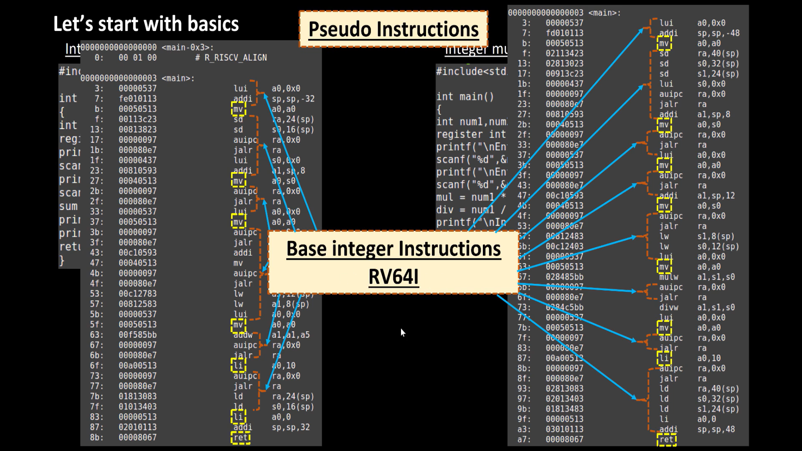

### RV64M – Multiply and Divide Extension

RV64M adds multiplication and division instructions to the base integer instruction set.

Examples:

- MUL – Multiplication
- MULH – Multiplication high bits
- DIV – Integer division
- REM – Remainder operation

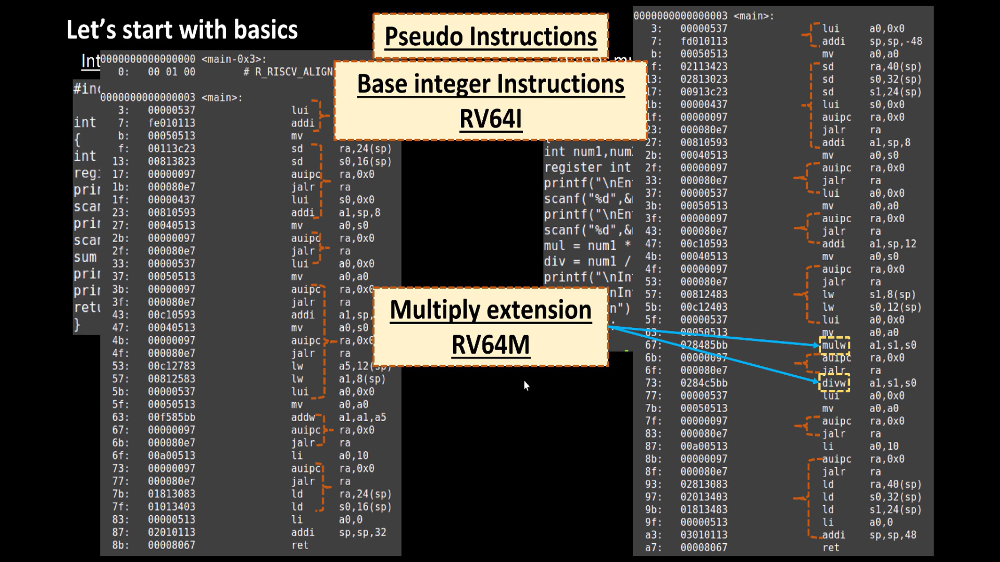

### RV64F and RV64D – Floating-Point Extensions

These extensions support floating-point operations.

**RV64F:** Single-precision floating-point operations (32-bit).

**RV64D:** Double-precision floating-point operations (64-bit).

Examples:

| Instruction | Function |
|---|---|
| FLW | Load single-precision value |
| FLD | Load double-precision value |
| FSW | Store single-precision value |
| FSD | Store double-precision value |
| FADD.S | Single-precision addition |
| FDIV.D | Double-precision division |

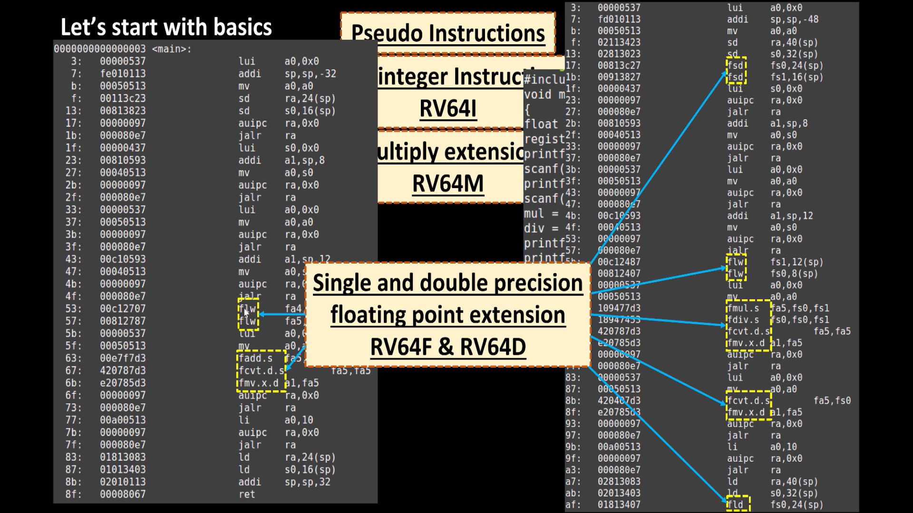

---

# 4. ABI – Application Binary Interface

ABI defines the conventions used by software components to communicate with each other.

It specifies:

- Register usage
- Function calling conventions
- Stack management
- Function arguments and return values

### Important RISC-V Registers

| Register | ABI Name | Purpose |
|---|---|---|
| x0 | zero | Always contains zero |
| x1 | ra | Return address |
| x2 | sp | Stack pointer |
| x5–x7 | t0–t2 | Temporary registers |
| x8–x9 | s0–s1 | Saved registers |
| x10–x17 | a0–a7 | Function arguments and return values |

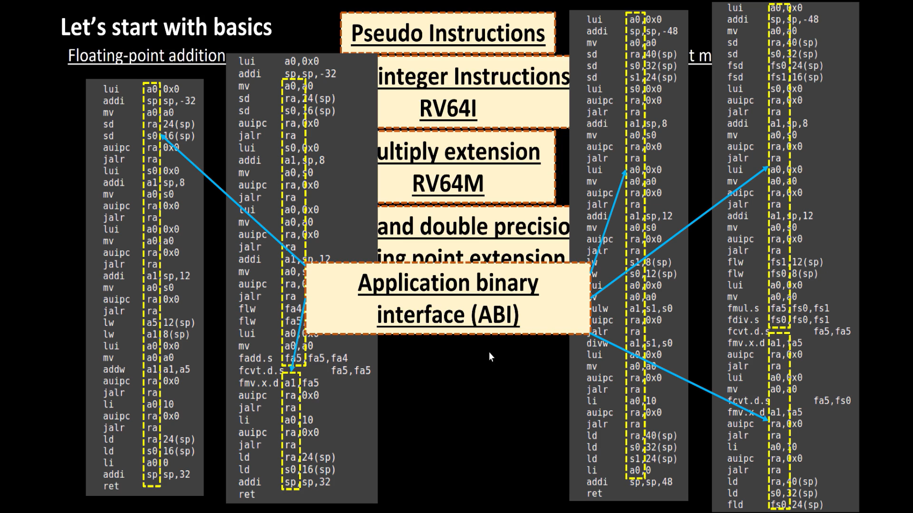

---

# 5. C Programming and RISC-V Compilation

C programming helps understand how high-level software is converted into processor instructions.

### Example: Addition of Two Numbers

```c
#include <stdio.h>

int main(void)
{
    int a = 10;
    int b = 20;
    int sum = a + b;

    printf("Sum = %d\n", sum);

    return 0;
}
```

### Expected Output

```text
Sum = 30
```

### RISC-V Compilation Commands

Compile the C program:

```bash
riscv64-unknown-elf-gcc -O1 -march=rv64i -mabi=lp64 -o sum.elf sum.c
```

Generate assembly code:

```bash
riscv64-unknown-elf-gcc -O1 -march=rv64i -mabi=lp64 -S sum.c -o sum.s
```

Generate disassembly:

```bash
riscv64-unknown-elf-objdump -d sum.elf
```

Check executable format:

```bash
riscv64-unknown-elf-objdump -f sum.elf
```

## Compiler Optimization

Compare different compiler optimization levels.

**O1 Optimization**

```bash
riscv64-unknown-elf-gcc -O1 -march=rv64i -mabi=lp64 -o sum_O1.elf sum.c
```

**Ofast Optimization**

```bash
riscv64-unknown-elf-gcc -Ofast -march=rv64i -mabi=lp64 -o sum_Ofast.elf sum.c
```

Inspect the generated machine instructions:

```bash
riscv64-unknown-elf-objdump -d sum_O1.elf

riscv64-unknown-elf-objdump -d sum_Ofast.elf
```

Compiler optimization can change the number and sequence of instructions generated.

The disassembly output helps understand how compiler decisions affect the final machine code.

---

# 6. RISC-V Toolchain

A toolchain is a collection of software tools used to convert source code into executable machine code.

| Tool | Purpose |
|---|---|
| GCC | Compiles C programs |
| Assembler | Converts assembly into machine code |
| Linker | Combines object files |
| objdump | Displays machine instructions |
| readelf | Displays ELF file information |

### Compilation Flow

```text
C Source Code
     |
     v
Compiler (GCC)
     |
     v
Assembly Code
     |
     v
Assembler
     |
     v
Object File
     |
     v
Linker
     |
     v
Executable ELF File
     |
     v
Disassembler (objdump)
     |
     v
RISC-V Machine Instructions
```

---

# 7. From ISA to RTL – PicoRV32

The Instruction Set Architecture defines **WHAT** a processor should execute.

RTL defines **HOW** the processor hardware implements those instructions.

PicoRV32 is a small RISC-V CPU core written in Verilog.

Studying PicoRV32 helps understand the connection between processor instructions and digital hardware.

## Three Major Stages

### Part 1 – RISC-V Instruction Set Architecture

- Understand instruction formats.
- Learn registers and instruction extensions.
- Study assembly instructions.
- Understand the relationship between C and assembly.

### Part 2 – RTL and Synthesis

- Explore PicoRV32 Verilog RTL.
- Understand processor datapath and control logic.
- Study how instructions are decoded.
- Convert RTL into a synthesized gate-level netlist.

### Part 3 – Physical Design

- Floorplanning
- Placement
- Clock Tree Synthesis
- Routing
- Chip Layout

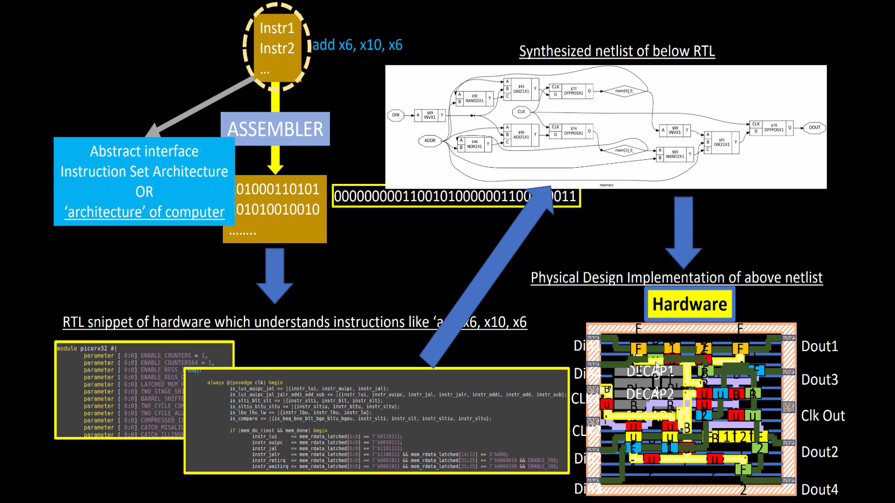

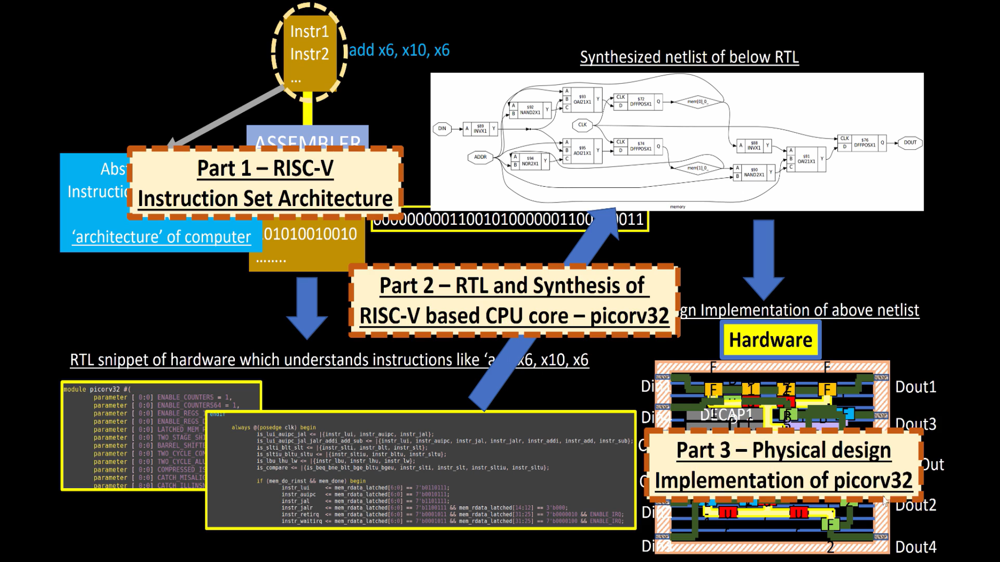

## RTL to Physical Design Flow

```text
RISC-V ISA
    |
    v
PicoRV32 RTL (Verilog)
    |
    v
RTL Synthesis
    |
    v
Gate-Level Netlist
    |
    v
Floorplanning
    |
    v
Placement
    |
    v
Clock Tree Synthesis
    |
    v
Routing
    |
    v
Final Chip Layout
```

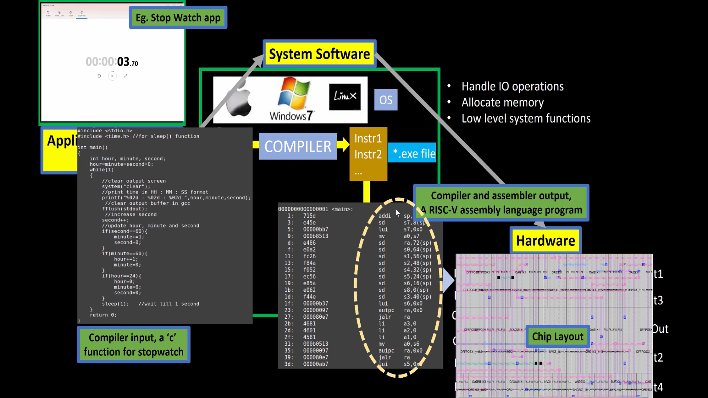

---

# 8. Development Environment

Practical experiments are performed using Ubuntu Linux running inside Oracle VirtualBox.

### Tools Explored

- Ubuntu Linux
- Oracle VirtualBox
- RISC-V GNU Toolchain
- GCC
- Assembler
- Linker
- objdump
- Verilog
- PicoRV32
- Yosys
- Physical Design Tools

The development environment is used to compile C programs, inspect assembly instructions, explore RTL, and perform synthesis-related experiments.

---

# 9. Learning Outcomes

Through this learning journey, I aim to develop practical understanding of:

- Computer Organization and Architecture.
- RISC-V Instruction Set Architecture.
- Binary number representation.
- Signed and unsigned number systems.
- C-to-Assembly and Assembly-to-Machine-Code conversion.
- RISC-V instruction formats and extensions.
- Pseudo-instructions and ABI.
- Compiler optimization and disassembly.
- Processor architecture and RTL implementation.
- Logic synthesis and gate-level netlists.
- RTL-to-GDSII physical design flow.

---

## Repository Structure

```text
RISCV/
│
├── RISCV_Lab1/
│
└── introduction/
    ├── README.md
    ├── No_Patterns.png
    ├── basic_1.png
    ├── basic_2.png
    ├── basic_3.png
    ├── basic_4.png
    ├── basic_5.png
    ├── behavioural_diagram.png
    ├── course_design.png
    ├── course_design_part.png
    ├── ex_behavioural_diagram.png
    ├── flow_diagram_1.png
    ├── number_explation.png
    └── range.png
```

*Note: The filenames above follow the uploaded introduction folder. Keep the actual filenames unchanged.*

---

## Repository Status

This repository is a continuous learning project.

Practical experiments, source codes, diagrams, screenshots, and implementation results will be added as the learning progresses.

## Key Topics

`RISC-V` `RV64I` `RV64M` `RV64F` `RV64D` `C Programming` `Assembly Language` `ABI` `PicoRV32` `Verilog RTL` `Yosys` `Synthesis` `Physical Design` `VLSI`
