# LAB 1 – RISC-V C Programming and Compiler Exploration

## About This Lab

This lab focuses on understanding the relationship between C programming, RISC-V compilation, machine instructions, and processor execution.

The main objective is to explore how C programs are compiled using the RISC-V GNU Toolchain, how signed and unsigned integer values are represented in a 64-bit architecture, and how compiler optimization affects the generated assembly instructions.

Practical experiments are performed using Ubuntu Linux, RISC-V GCC, and the Spike RISC-V ISA Simulator.

---

# 1. C Programming – Basic Implementation

The first experiment focuses on writing and executing a simple C program to calculate the sum of natural numbers.

### Example: Sum of Numbers from 1 to 100

**C Program:**

```c
#include <stdio.h>

int main()
{
    int i, sum = 0, n = 100;

    for(i = 1; i <= n; ++i)
    {
        sum += i;
    }

    printf("Sum of numbers from 1 to %d is %d\n", n, sum);

    return 0;
}
```

**Compilation using GCC:**

```bash
gcc sumiton.c
./a.out
```

**Expected Output:**

```text
Sum of numbers from 1 to 100 is 5050
```

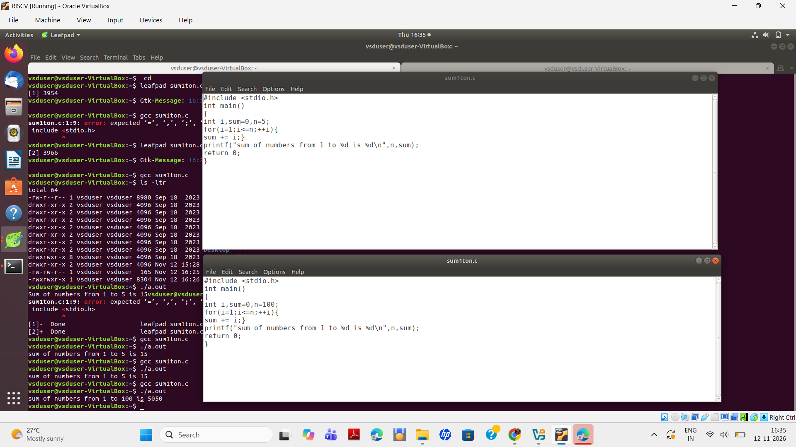

### Learning Points

- Understanding C program structure.
- Variable declaration and initialization.
- Using loops for repetitive operations.
- Performing arithmetic operations.
- Understanding program compilation and execution.

---

# 2. RISC-V Cross Compilation

After executing the program using the native GCC compiler, the next step is to compile it for the RISC-V architecture.

The RISC-V GNU Compiler generates executable code for the target RISC-V processor.

### Compilation Command

```bash
riscv64-unknown-elf-gcc -Ofast -mabi=lp64 -march=rv64i -o sumiton.o sumiton.c
```

### Command Explanation

| Option | Description |
|---|---|
| `riscv64-unknown-elf-gcc` | RISC-V cross compiler |
| `-Ofast` | Enables aggressive compiler optimization |
| `-mabi=lp64` | Specifies 64-bit integer and pointer ABI |
| `-march=rv64i` | Selects RV64I architecture |
| `-o sumiton.o` | Specifies output filename |
| `sumiton.c` | Input C source file |

### Executing Through Spike

```bash
spike pk sumiton.o
```

Spike simulates the execution of the RISC-V program.

**Output:**

```text
bbl loader

Sum of numbers from 1 to 100 is 5050
```

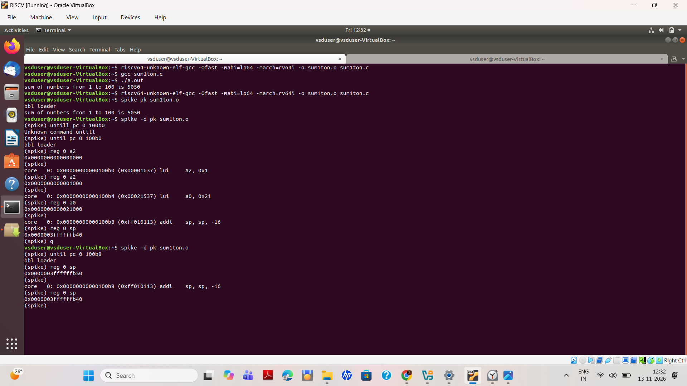

### Learning Points

- Difference between native and cross compilation.
- Understanding target architecture.
- RISC-V executable generation.
- Running RISC-V programs using Spike.

---

# 3. Understanding Signed and Unsigned Numbers

In computer architecture, signed and unsigned data types determine how binary values are interpreted.

For a 64-bit integer:

### Signed Integer Range

A signed 64-bit integer uses two's complement representation.

\[
\text{Maximum}=2^{63}-1
\]

\[
\text{Minimum}=-2^{63}
\]

Therefore:

| Type | Minimum Value | Maximum Value |
|---|---:|---:|
| Signed 64-bit | -9223372036854775808 | 9223372036854775807 |

### Unsigned Integer Range

An unsigned 64-bit integer represents only non-negative values.

\[
\text{Minimum}=0
\]

\[
\text{Maximum}=2^{64}-1
\]

| Type | Minimum Value | Maximum Value |
|---|---:|---:|
| Unsigned 64-bit | 0 | 18446744073709551615 |

---

# 4. Experiment: Unsigned Integer Representation

The experiment explores the maximum value that can be represented using an unsigned integer.

### C Program

```c
#include <stdio.h>

int main()
{
    unsigned long long int max = 18446744073709551615ULL;

    printf("Highest number represented by unsigned long long int is %llu\n", max);

    return 0;
}
```

### Compilation

```bash
riscv64-unknown-elf-gcc -Ofast -mabi=lp64 -march=rv64i -o unsignedHighest.o unsignedHighest.c
```

### Execution

```bash
spike pk unsignedHighest.o
```

**Output:**

```text
Highest number represented by unsigned long long int is 18446744073709551615
```

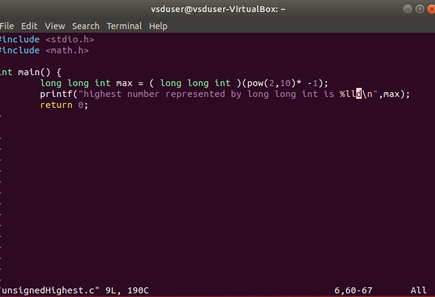

### Different Bit-Width Experiments

The following experiments explore different powers of two.

| Number of Bits | Maximum Unsigned Value |
|---|---:|
| 10 bits | 1023 |
| 64 bits | 18446744073709551615 |
| 127 bits | Cannot be represented by a 64-bit integer |

### 10-bit Experiment

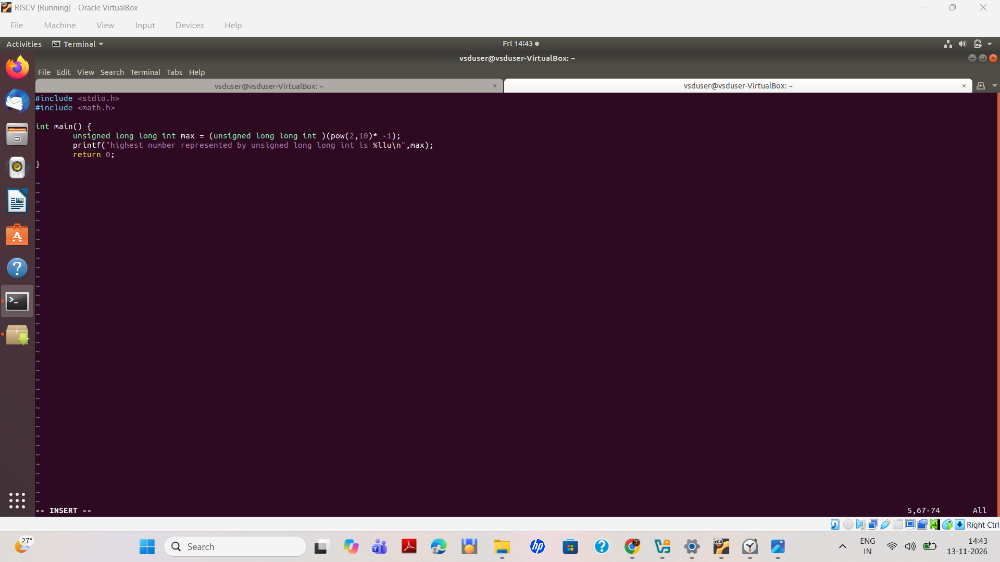

### 64-bit Experiment

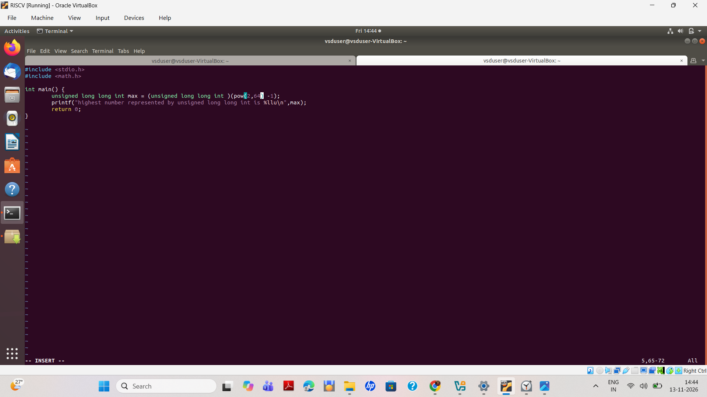

### 127-bit Experiment

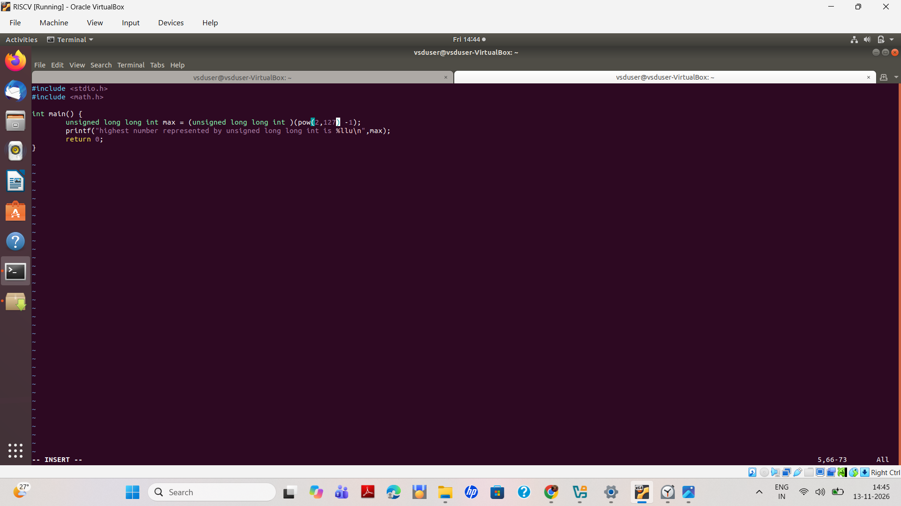

### Execution Results

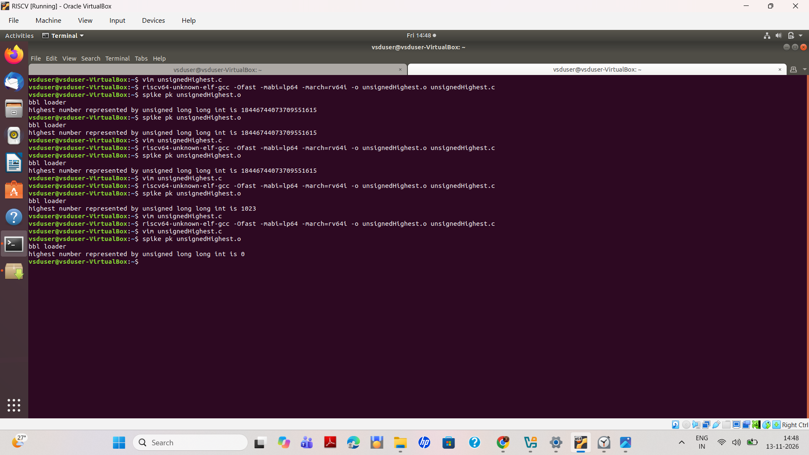

### Important Observation

A 64-bit unsigned integer can represent values from 0 to \(2^{64}-1\).

A 127-bit value exceeds the capacity of this data type.

The experiments also demonstrate why floating-point calculations using `pow()` should not be relied upon for exact representation of large integer limits.

---

# 5. Experiment: Signed Integer Representation

This experiment explores the minimum and maximum values of a signed 64-bit integer.

### C Program

```c
#include <stdio.h>
#include <stdint.h>
#include <inttypes.h>

int main()
{
    int64_t max = INT64_MAX;
    int64_t min = INT64_MIN;

    printf("Highest number represented by signed 64-bit integer is %" PRId64 "\n", max);

    printf("Lowest number represented by signed 64-bit integer is %" PRId64 "\n", min);

    return 0;
}
```

### Compilation

```bash
riscv64-unknown-elf-gcc -Ofast -mabi=lp64 -march=rv64i -o signedHighest.o signedHighest.c
```

### Execution

```bash
spike pk signedHighest.o
```

**Expected Output:**

```text
Highest number represented by signed 64-bit integer is 9223372036854775807

Lowest number represented by signed 64-bit integer is -9223372036854775808
```

### Initial Code

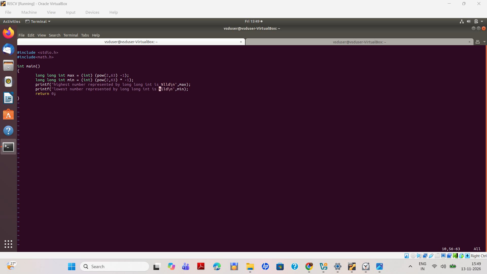

### Debugging Process

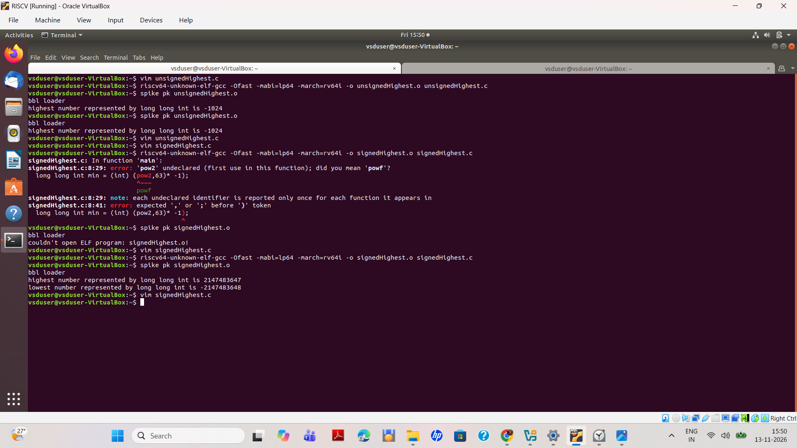

### Corrected Code

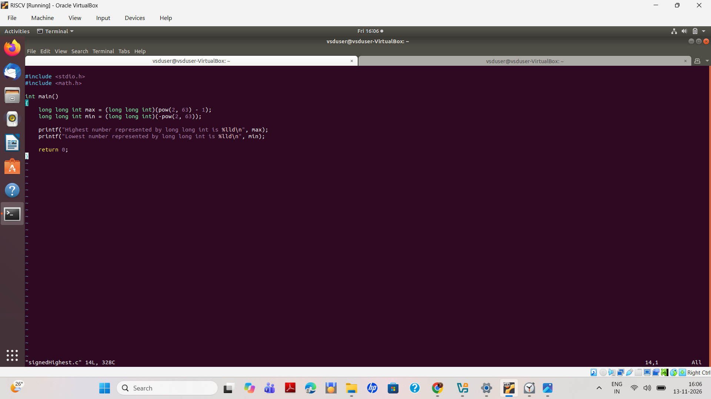

### Final Execution Result

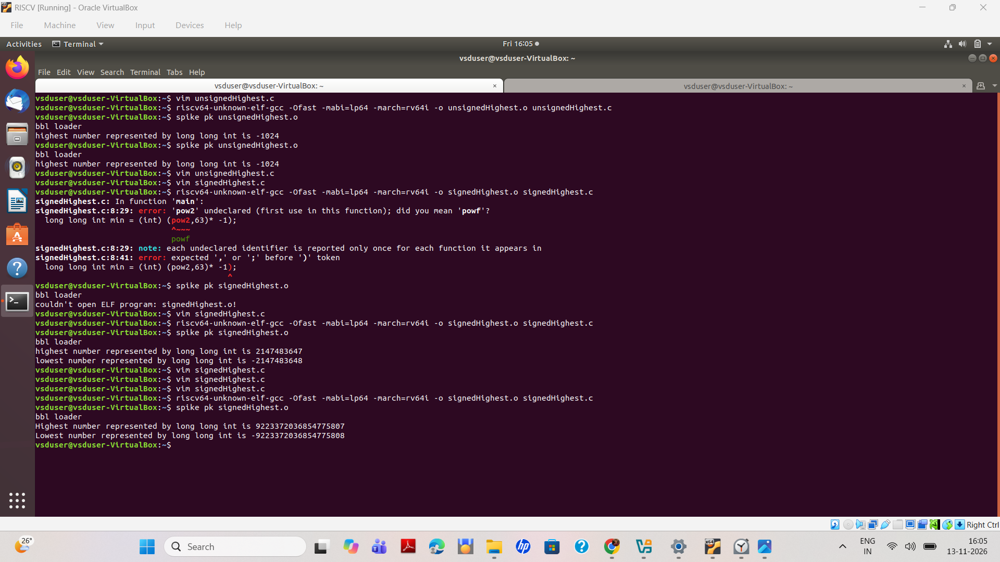

### Learning Points

- Understanding signed integer representation.
- Two's complement number system.
- Minimum and maximum values of 64-bit integers.
- Identifying C programming errors.
- Understanding data-type limitations.

---

# 6. Compiler Optimization: O1 vs Ofast

Compiler optimization improves the generated machine code by applying different optimization techniques.

In this experiment, the same C program is compiled using two optimization levels.

### O1 Optimization

```bash
riscv64-unknown-elf-gcc -O1 -mabi=lp64 -march=rv64i -o sumiton.o sumiton.c
```

### Ofast Optimization

```bash
riscv64-unknown-elf-gcc -Ofast -mabi=lp64 -march=rv64i -o sumiton.o sumiton.c
```

### Generate Assembly and Disassembly

```bash
riscv64-unknown-elf-gcc -O1 -mabi=lp64 -march=rv64i -S sumiton.c -o sumiton_O1.s

riscv64-unknown-elf-gcc -Ofast -mabi=lp64 -march=rv64i -S sumiton.c -o sumiton_Ofast.s
```

To inspect the generated instructions:

```bash
riscv64-unknown-elf-objdump -d sumiton.o
```

### O1 Register Address and Instruction Output

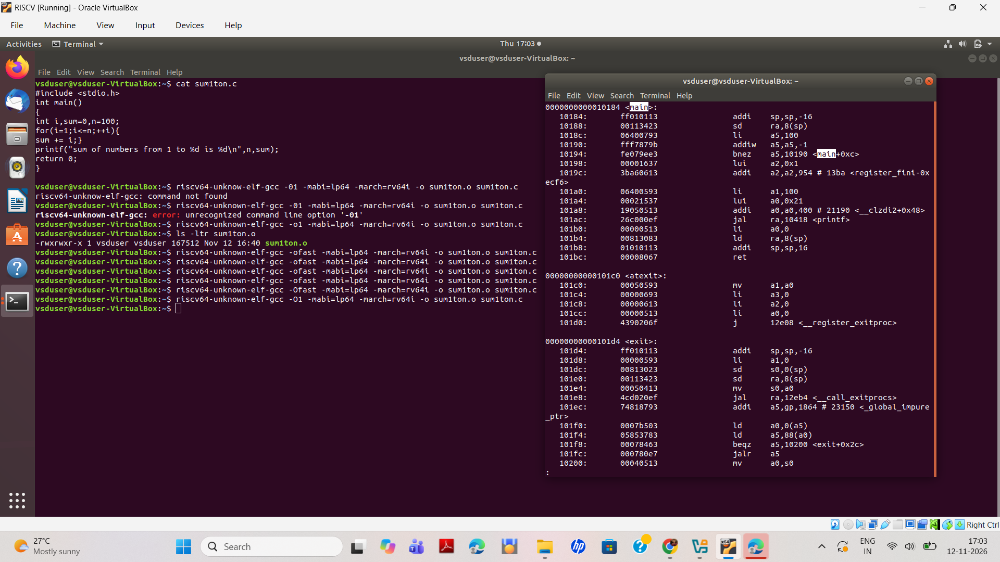

### Ofast Register Address and Instruction Output

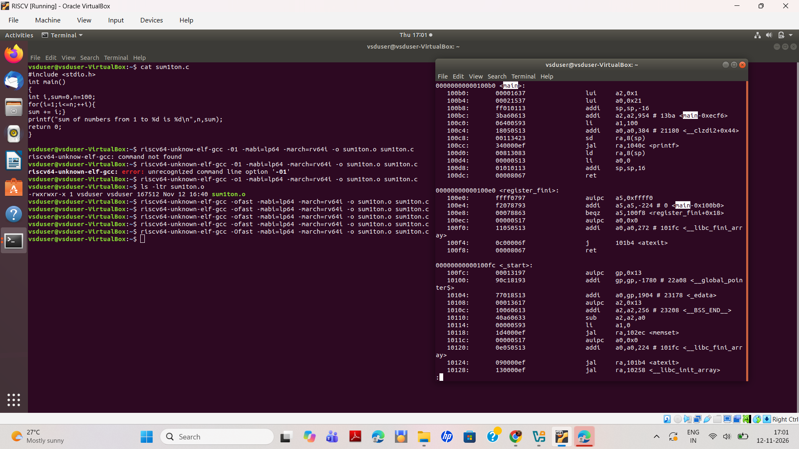

### Comparison

| Feature | O1 | Ofast |
|---|---|---|
| Optimization | Moderate | Aggressive |
| Compilation | Optimized code | More aggressive optimization |
| Execution | Optimized execution | May improve execution performance |
| Code generation | Depends on compiler | Depends on compiler |

### Learning Points

- Understanding compiler optimization.
- Comparing generated assembly instructions.
- Observing register allocation.
- Understanding how optimization changes instruction sequences.

---

# 7. Understanding RISC-V LUI and ADDI Instructions

RISC-V uses different instruction formats to perform operations.

Two important instructions explored in this experiment are:

### LUI – Load Upper Immediate

The LUI instruction loads an immediate value into the upper bits of a destination register.

Example:

```asm
lui a0, 0x32143
```

### ADDI – Add Immediate

The ADDI instruction adds a sign-extended immediate value to the source register and stores the result in the destination register.

Example:

```asm
addi a0, a0, 0x300
```

### LUI Instruction Explanation

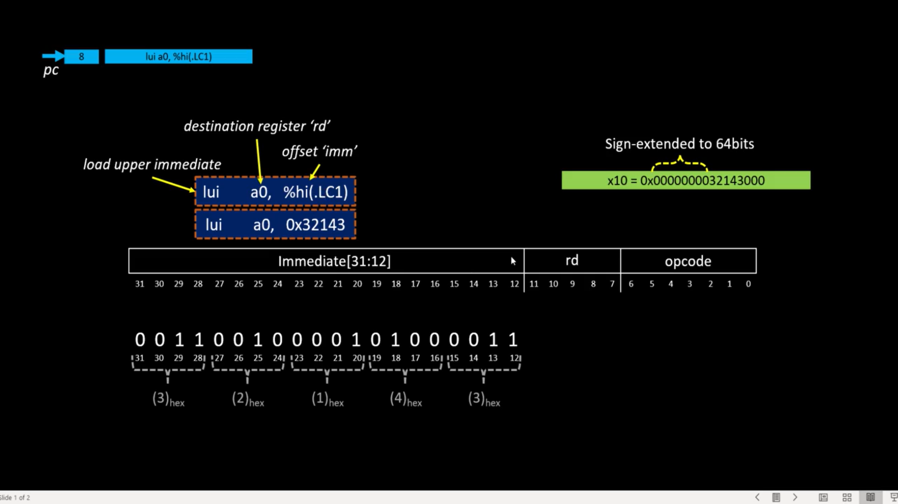

### ADDI Instruction Explanation

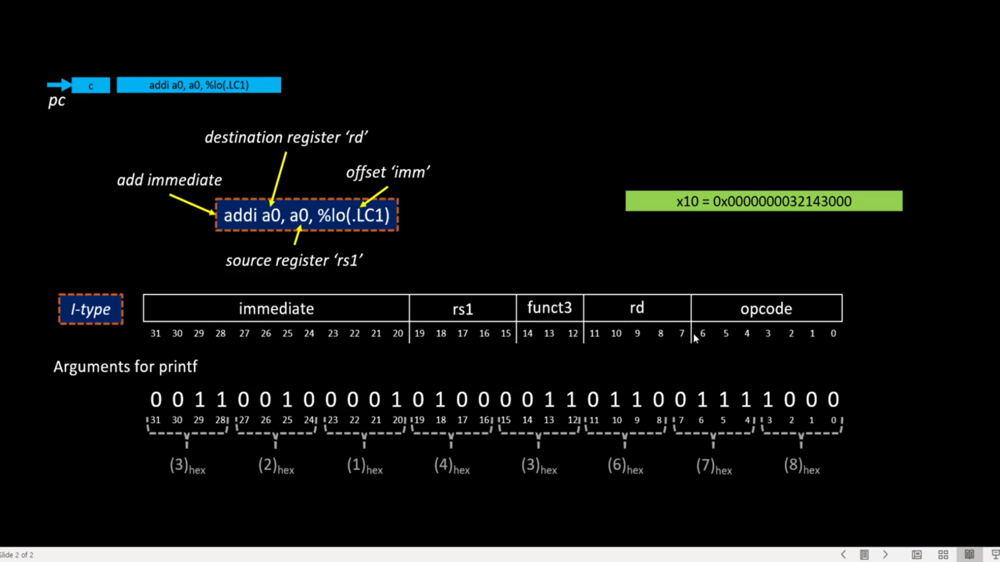

### Learning Points

- Understanding RISC-V instruction formats.
- Destination register (rd).
- Source register (rs1).
- Immediate values.
- Opcode and instruction encoding.
- Understanding how immediate values are constructed.

---

# 8. Spike Debugging and Register Inspection

Spike is a RISC-V ISA simulator that allows us to execute and debug RISC-V programs.

The debug mode helps inspect program execution and processor register values.

### Start Spike in Debug Mode

```bash
spike -d pk sumiton.o
```

### Useful Debugging Commands

```text
until pc 0 100b0
```

Stops execution when the program counter reaches the specified address.

```text
reg 0 a0
```

Displays the value of register a0.

```text
reg 0 sp
```

Displays the stack pointer value.

```text
q
```

Exits the debugger.

### Register Inspection

The screenshots demonstrate inspection of:

- a0 – Function argument and return-value register.
- a2 – Function argument register.
- sp – Stack pointer.
- PC – Program counter.


---

# 9. Practical Observations

The following observations were made during the experiments:

1. Native GCC compiles programs for the host architecture.
2. RISC-V GCC generates code for the RISC-V target architecture.
3. Spike executes RISC-V programs through instruction-set simulation.
4. Signed integers use two's complement representation.
5. Unsigned integers represent only non-negative values.
6. The maximum representable integer depends on the data width.
7. Compiler optimization affects generated assembly instructions.
8. LUI and ADDI are important for constructing immediate values.
9. Spike debugging helps understand register values and instruction execution.

---

# 10. Learning Outcomes

After completing this lab, I gained practical exposure to:

- C programming fundamentals.
- RISC-V GNU Toolchain.
- Cross compilation.
- RV64I architecture.
- Signed and unsigned integer representation.
- Two's complement.
- Data-width limitations.
- Compiler optimization levels.
- Assembly and machine-code inspection.
- LUI and ADDI instructions.
- Spike ISA Simulator.
- Register and program-counter inspection.

---

# 11. Tools and Technologies

| Tool | Purpose |
|---|---|
| Ubuntu Linux | Development environment |
| C Programming | Source-code development |
| GCC | Native compilation |
| RISC-V GNU Toolchain | RISC-V cross compilation |
| Spike | RISC-V instruction-set simulation |
| objdump | Assembly and disassembly inspection |
| Vim / Leafpad | Source-code editing |
| Oracle VirtualBox | Virtual Linux environment |

---

## Repository Structure

```text
RISCV/
│
├── introduction/
│   └── README.md
│
└── lab1/
    ├── README.md
    ├── Adi_expln.png
    ├── O1_register_address.png
    ├── Ofast_register_address.png
    ├── debug signed code.png
    ├── debug.png
    ├── lui_expln.png
    ├── signed before_bebug.png
    ├── signed_debug_after.png
    ├── signed_prob_before _debug.png
    ├── sum_no..png
    ├── unsigned_10.png
    ├── unsigned_64.png
    ├── unsigned_127.png
    ├── unsigned_no_Result.png
    └── unsigned_program.png
```

---

## Conclusion

Lab 1 establishes the foundation for understanding how C programs are translated into RISC-V machine instructions.

Through practical experiments with integer representation, compiler optimization, cross compilation, and Spike debugging, I explored the connection between high-level programming and processor architecture.

This knowledge provides a foundation for further exploration of RISC-V assembly language, instruction decoding, processor datapath, and RTL implementation.

---

**Key Topics:** `C Programming` `RISC-V` `RV64I` `Cross Compilation` `GCC` `Signed Integers` `Unsigned Integers` `Compiler Optimization` `Assembly Language` `LUI` `ADDI` `Spike Simulator` `Register Debugging`

