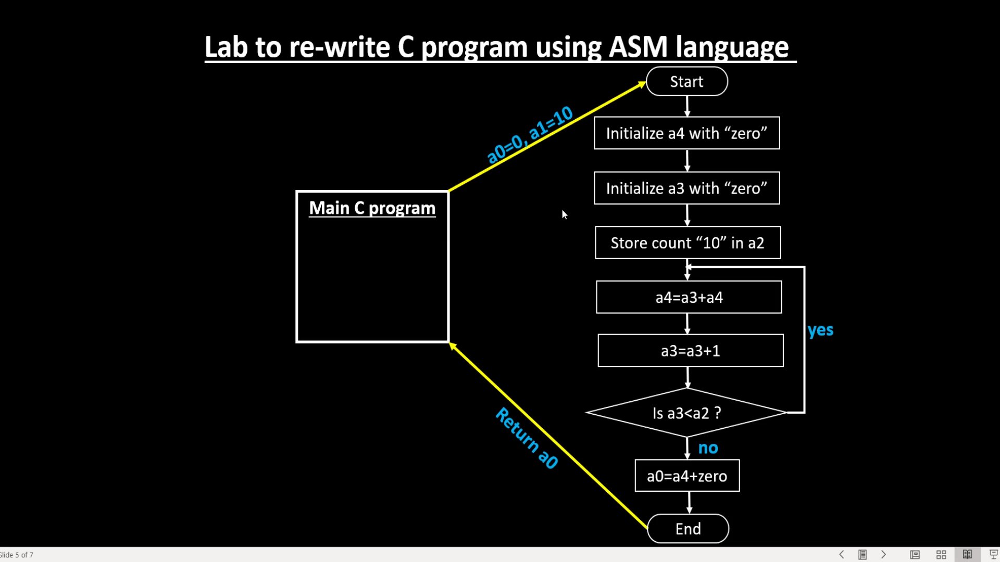
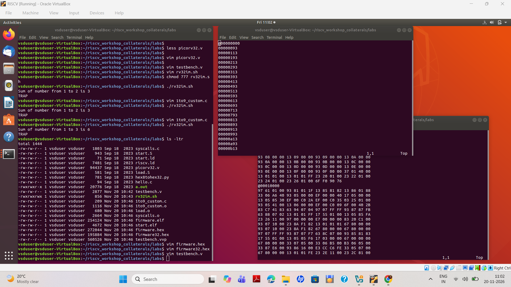
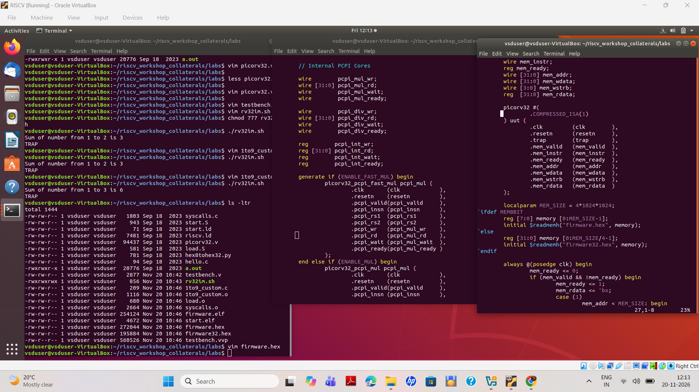
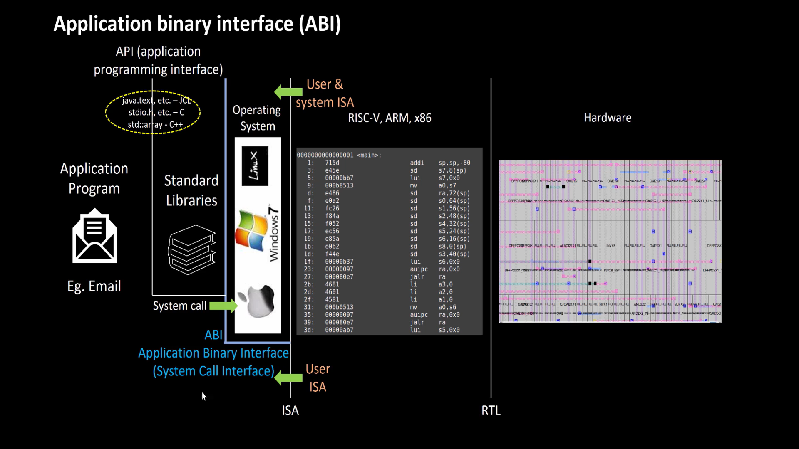
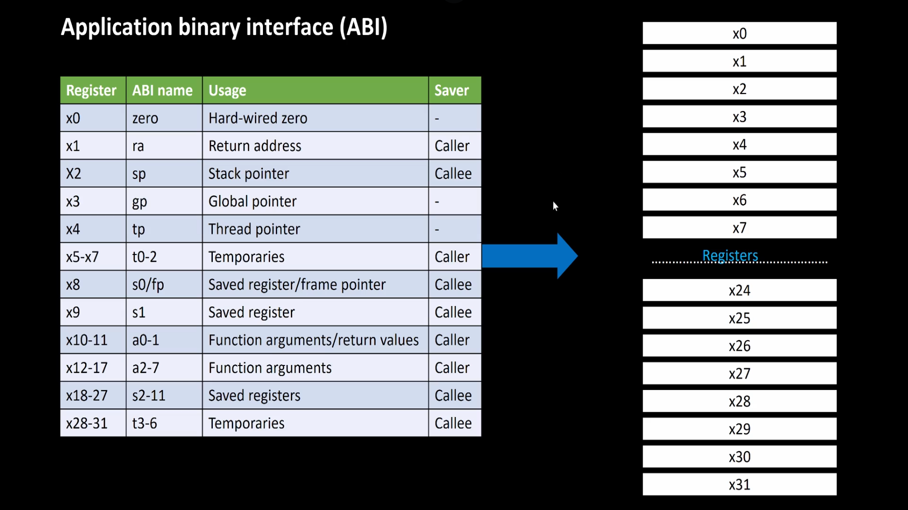
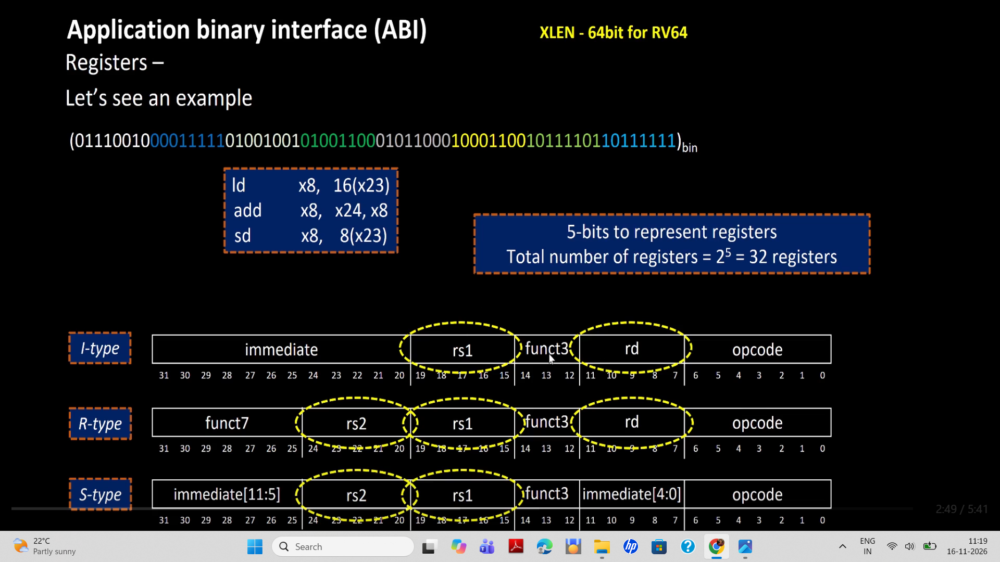
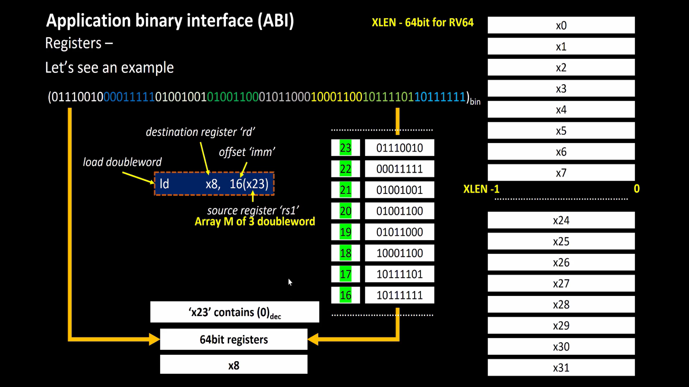

# Lab 2 – RISC-V Software and Hardware Execution

## Objective

To understand how a C program is converted into RISC-V Assembly instructions and executed using a RISC-V processor. This lab covers C programming, Assembly language, ABI, register conventions, instruction formats, machine code generation, and RISC-V CPU simulation using Verilog HDL.

## Tools and Technologies

- Ubuntu Linux
- RISC-V GCC Cross Compiler
- Spike RISC-V ISA Simulator
- RISC-V Proxy Kernel (PK)
- RISC-V objdump
- Verilog HDL
- PicoRV32 Processor
- Verilog Testbench

---

## 1. C Programming – Sum of Numbers from 1 to 9

The first exercise involves writing a C program to calculate the sum of numbers from 1 to 9 using an external Assembly function named `load()`.

### C Program (`1to9_custom.c`)

```c
#include <stdio.h>

extern int load(int x, int y);

int main()
{
    int result = 0;
    int count = 9;

    result = load(0x0, count+1);

    printf("Sum of numbers from 1 to %d is %d\n",
           count, result);
}
```

### Explanation

- `extern` declares a function implemented separately.
- `count` stores the upper limit (9).
- `load()` is called with arguments 0 and 10.
- The returned sum is stored in `result`.

### Expected Output

```text
Sum of numbers from 1 to 9 is 45
```

### Screenshot


---

## 2. C Program to RISC-V Assembly Conversion

In this exercise, the summation logic is implemented using RISC-V Assembly instructions.

### Assembly Code (`load.s`)

```asm
.section .text
.global load
.type load, @function

load:
    add  a4, a0, zero
    add  a2, a0, a1
    add  a3, a0, zero

loop:
    add  a4, a3, a4
    addi a3, a3, 1
    blt  a3, a2, loop

    add  a0, a4, zero
```

### Instruction Explanation

| Instruction | Description |
|---|---|
| ADD | Adds two register values |
| ADDI | Adds an immediate value |
| BLT | Branch if less than |
| ZERO | Constant zero register |

### Working Principle

1. Initialize the sum register with zero.
2. Initialize the loop counter with zero.
3. Add the counter to the accumulated sum.
4. Increment the counter by one.
5. Check the loop condition using BLT.
6. Repeat until the counter reaches 10.
7. Store the final result in register `a0`.

**Final Result: 45**

### Flow Diagram

The flow diagram illustrates the conversion of the C program logic into RISC-V Assembly instructions.


### Assembly Code Screenshot



---

## 3. RISC-V Program Compilation and Execution

The C and Assembly source files are compiled using the RISC-V cross compiler.

### Compilation Command

```bash
riscv64-unknown-elf-gcc -Ofast -mabi=lp64 -march=rv64i -o 1to9_custom.o 1to9_custom.c load.s
```

### Execute Using Spike Simulator

```bash
spike pk 1to9_custom.o
```

### Expected Output

```text
Sum of numbers from 1 to 9 is 45
```

### Disassemble the Executable

```bash
riscv64-unknown-elf-objdump -d 1to9_custom.o | less
```

The `objdump` command displays the disassembled RISC-V instructions generated by the compiler.

### HEX File

The hexadecimal representation of the program is used for memory initialization in the Verilog simulation environment.



---

## 4. Running a C Program on RISC-V CPU

This exercise introduces the execution of a C program on a RISC-V processor designed using Verilog HDL.

### Main Components

- RISC-V CPU written in Verilog HDL.
- Memory containing the HEX representation of the program.
- Display for showing the program execution result.

### Execution Flow

1. Write the C program.
2. Convert the program into RISC-V machine instructions.
3. Generate the HEX memory initialization file.
4. Load the program into memory.
5. Execute the instructions using the RISC-V CPU.
6. Observe the calculated result.

### RISC-V CPU Execution Flow Diagram


---

## 5. RISC-V CPU and Verilog Testbench

The PicoRV32 processor is instantiated in the Verilog testbench to simulate RISC-V instruction execution.

### CPU Instantiation

```verilog
picorv32 #(
    .COMPRESSED_ISA(1)
) uut (
    .clk        (clk),
    .resetn     (resetn),
    .trap       (trap),
    .mem_valid  (mem_valid),
    .mem_instr  (mem_instr),
    .mem_ready  (mem_ready),
    .mem_addr   (mem_addr),
    .mem_wdata  (mem_wdata),
    .mem_wstrb  (mem_wstrb),
    .mem_rdata  (mem_rdata)
);
```

### Memory Initialization

```verilog
`ifdef MEM32BIT
    reg [7:0] memory [0:MEM_SIZE-1];
    initial $readmemh("firmware32.hex", memory);
`else
    reg [31:0] memory [0:MEM_SIZE/4-1];
    initial $readmemh("firmware.hex", memory);
`endif
```

### Important Signals

| Signal | Description |
|---|---|
| clk | Clock signal |
| resetn | Active-low reset |
| trap | Trap indication |
| mem_valid | Valid memory transaction |
| mem_instr | Instruction-fetch indication |
| mem_ready | Memory transaction completion |
| mem_addr | Memory address |
| mem_wdata | Memory write data |
| mem_wstrb | Byte write strobe |
| mem_rdata | Memory read data |

### CPU and Testbench Screenshot



---

## 6. Application Binary Interface (ABI)

ABI stands for Application Binary Interface.

It defines how compiled software components communicate with each other.

### Important ABI Concepts

- Function calling conventions
- Register usage
- Argument passing
- Return values
- Stack management
- Caller-saved and callee-saved registers

### API vs ABI

| API | ABI |
|---|---|
| Application Programming Interface | Application Binary Interface |
| Defines source-level interaction | Defines binary-level interaction |
| Used during software development | Used by compilers, linkers and runtime systems |

### ABI Interface



---

## 7. RISC-V Register Calling Convention

RISC-V provides 32 general-purpose integer registers.

Each register has an ABI name and a specific conventional purpose.

### Register Table

| Register | ABI Name | Usage |
|---|---|---|
| x0 | zero | Constant zero |
| x1 | ra | Return address |
| x2 | sp | Stack pointer |
| x3 | gp | Global pointer |
| x4 | tp | Thread pointer |
| x5-x7 | t0-t2 | Temporary registers |
| x8-x9 | s0-s1 | Saved registers |
| x10-x11 | a0-a1 | Arguments / Return values |
| x12-x17 | a2-a7 | Function arguments |
| x18-x27 | s2-s11 | Saved registers |
| x28-x31 | t3-t6 | Temporary registers |

### Caller-Saved and Callee-Saved Registers

- Caller-saved registers do not need to be preserved by the called function.
- Callee-saved registers must be restored by the called function if modified.

### Register Calling Convention Screenshot



---

## 8. RISC-V Instruction Set and Instruction Formats

RISC-V instructions use different formats to represent operations and operands.

Five bits are used to represent a register because:

```text
2^5 = 32 registers
```

### R-Type Format

Used for register-to-register operations.

Example:

```asm
add x8, x24, x8
```

| Field | Bits |
|---|---:|
| funct7 | 7 |
| rs2 | 5 |
| rs1 | 5 |
| funct3 | 3 |
| rd | 5 |
| opcode | 7 |
| Total | 32 |

### I-Type Format

Used for immediate operations and load instructions.

Example:

```asm
ld x8, 16(x23)
```

| Field | Bits |
|---|---:|
| Immediate | 12 |
| rs1 | 5 |
| funct3 | 3 |
| rd | 5 |
| opcode | 7 |
| Total | 32 |

### S-Type Format

Used for store instructions.

Example:

```asm
sd x8, 8(x23)
```

| Field | Bits |
|---|---:|
| Immediate[11:5] | 7 |
| rs2 | 5 |
| rs1 | 5 |
| funct3 | 3 |
| Immediate[4:0] | 5 |
| opcode | 7 |
| Total | 32 |

### Instruction Set Screenshot



---

## 9. Load, Add and Store Instructions

This exercise explains how RISC-V instructions interact with registers and memory.

### A. Load Doubleword (LD)

```asm
ld x8, 16(x23)
```

Loads 64-bit data from memory into register `x8`.

```text
x8 = Memory[x23 + 16]
```

### B. Addition (ADD)

```asm
add x8, x24, x8
```

Adds the values of `x24` and `x8`.

```text
x8 = x24 + x8
```

### C. Store Doubleword (SD)

```asm
sd x8, 8(x23)
```

Stores 64-bit data from register `x8` into memory.

```text
Memory[x23 + 8] = x8
```

### Instruction Execution Flow

```text
Memory
   |
   v
Load Data (LD)
   |
   v
Register x8
   |
   v
ALU Addition (ADD)
   |
   v
Register x8
   |
   v
Store Data (SD)
   |
   v
Memory
```

### Load Data Register Screenshot



---

## 10. Key Learning Outcomes

Through this lab, I learned:

- How to write a C program using an external Assembly function.
- How to implement loops and arithmetic operations using RISC-V Assembly.
- How C and Assembly communicate through the ABI.
- RISC-V register naming and calling conventions.
- Cross-compilation using the RISC-V GCC toolchain.
- Executing RISC-V programs using the Spike simulator.
- Understanding ELF files and disassembled machine instructions.
- Basic RISC-V CPU implementation using Verilog HDL.
- Memory initialization using HEX files.
- Understanding RISC-V instruction formats: R-Type, I-Type and S-Type.
- Understanding load, arithmetic and store operations.

---

## Conclusion

Lab 2 provides an understanding of the relationship between software programming and processor hardware.

Starting with a C program, the lab explores Assembly programming, RISC-V instruction encoding, ABI, register conventions, compilation and processor simulation.

It also introduces the implementation and verification of a RISC-V CPU using Verilog HDL.

**Key Result:** Successfully executed the sum-of-numbers program using the RISC-V software toolchain and studied the hardware execution flow.

---

## Technologies and Topics

`RISC-V` `Assembly Language` `C Programming` `Verilog HDL` `PicoRV32` `ABI` `ISA` `ELF` `HEX` `CPU Architecture` `Digital Design` `RTL Design`

